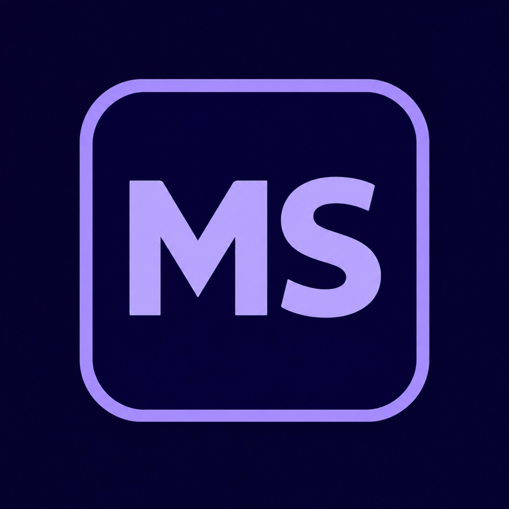

# MotionStudio **2026.0.0-alpha**

Open-source NLE + motion graphics foundation.



**Status:** Alpha — milestones 1–30 implemented at source level; native release checks pass; Android/device validation still required before production release.

| Layer | Stack |
|-------|--------|
| Core | C++17 (`native/cpp`) |
| Timeline / graph | MLT (optional) + own session model |
| Decode | libav (optional) / FFmpeg CLI |
| Effects | CPU builtins + frei0r catalog |
| UI | **Kotlin + Jetpack Compose** (`android/`), one `MainActivity` |
| Bridge | JNI over the C ABI in `native/cpp/bridge/ms_bridge.h` |
| License | **GPL-3.0** (see `LICENSE`) |

> **Architecture change (2026-11-12):** the Flutter/Dart UI was removed. The
> Android app is now Kotlin + Jetpack Compose calling the C++ engine over JNI —
> no Dart, no Flutter engine, no widget layer in between. See
> `android/README.md` for the module layout and build commands.

---

## Quick start (Android app)

```bash
cd android
./gradlew :app:assembleDebug     # or: gradle :app:assembleDebug
```

Requires JDK 17, Android SDK 35, NDK 27 and CMake 3.22. The engine is compiled
from `native/cpp` by CMake as part of the Gradle build; the debug APK is written
to `android/app/build/outputs/apk/debug/app-debug.apk`.

## Quick start (native smoke)

```bash
# Optional deps: libav, MLT, ffmpeg CLI
sudo apt install ffmpeg libavformat-dev libavcodec-dev libavutil-dev libswscale-dev libmlt-dev

cd native/cpp
# Example M1 decode test (when sources present):
# g++ -std=c++17 -DMS_HAVE_LIBAV -I include ... -o ms_m1_test $(pkg-config --libs libavformat libavcodec libavutil libswscale)
```

Scripts: `scripts/test_native.sh` (if present).

### Flutter / Android

```bash
cd flutter_ui
./scripts/prepare_android.sh   # needs Flutter + Android SDK on *your* machine
```

---

## What’s in 2026.0.0-alpha

- Project / timeline / clips  
- Playback decode path + frame buffer for Texture  
- Effects host + offline effects; online catalog client  
- Export presets + lossless cut/join  
- Auto scene/silence cuts, captions, JSON templates  
- DCC job hooks (Blender / MoonRay / Gaffer style exports)

## What’s not

- Full GPU compositor  
- Production OpenFX host  
- Nested sequences / multicam  
- Store-ready Android binary from this environment  

---

## Online effects

Point the app at:

`https://raw.githubusercontent.com/H1lol/ms-effects/main/catalog.json`

Ship plugins as `.msp` (see `docs/plugins/`).

---

## Version

```
2026.0.0-alpha
```

See `CHANGELOG.md` and `docs/MILESTONE*.md`.

## License

GPL-3.0 — `LICENSE`. Respect FFmpeg/MLT/frei0r terms when you ship binaries.


## Native foundation status
Milestones 1-10 are wired through the C++ engine: project/session model, timeline editing, media probing/decoding, frame compositing, keyframed clip motion, CPU effects, render/export, masks/blending modules, and node-graph evaluation. Flutter can access the native engine through the C ABI in `native/cpp/bridge/ms_bridge.h`. The obsolete Rust layer from the rebuild has been removed; Motion Studio core remains Flutter + C++ + Python + HTML/CSS.

## Milestones 23–30

Settings/theme controls, starter panel, touch-performance policy, atomic media/project storage, Android packaging scaffold, recovery/release checks, performance gates, and GPLv3/third-party audit documentation are included. See `docs/MILESTONE23_30.md`.

## Motion Studio UI refresh (2026-11-03)

The current Flutter UI uses the canonical mobile-first Motion Studio design direction: branded starter panel, project setup, Motion Dark surfaces with a violet accent, adaptive editor, composition canvas, multi-layer timeline, inspector, effects, Nodes, 3D, Color, Audio, and Export workspaces. See `docs/MOTION_STUDIO_UI_BUILD_2026-11-03.md` and `docs/MOTION_STUDIO_UI_MASTER_PROMPT_FIXED.txt`.

The import picker, C++ project persistence, native preview frame delivery, and final render backend still need platform wiring. Those items are called out in the UI rather than represented as completed operations.

## Upstream-informed native improvements (2026-11-04)

This update adds stateful native master/track playback insert chains (gain, 3-band EQ, compressor, delay, reverb, and limiter), safer compositor graph validation with alpha-over/saturation/invert operations, additional export delivery profiles, and an optional Appleseed project handoff. Selected upstream source references and license texts are documented in `third_party/upstream_reference_sources/` and `THIRD_PARTY.md`.

Run the native regression suite with:

```bash
./scripts/test_native.sh
```

The Appleseed handoff currently emits sphere proxy geometry for mesh references; real mesh/material translation remains future work. The audio insert chains are active in native `AudioMixer`, `AudioPlayback`, and `TimelineAudioPlayback` PCM processing, and the `Engine` now drives `TimelineAudioPlayback` end to end: `ms_audio_state`, `ms_audio_read_pcm` and `ms_audio_set_master_gain` expose the mixed PCM and master chain to the host, with the playhead kept in step with video seek/play/pause/render ticks. Only the platform audio device callback is left to the host. Flutter compilation and device validation are not claimed by this native-only verification.


### Blender 5.2.2 integration

Motion Studio can generate a Blender Python job from its native 3D scene model. See `docs/BLENDER_INTEGRATION_2026-11-04.md` for supported asset formats, current limitations, validation, and selected upstream references.


## Mobile editor layout update (2026-11-04)

The mobile editor keeps the same MS visual identity and workspace model as desktop while adapting the spatial layout to touch: compact project header, scrollable Edit/Animation/Compositing/Nodes/3D/Color/Audio/Export selector, composition preview, playback controls, timeline actions, multi-layer timeline, and a horizontally scrollable tool dock. On narrow phones, Export becomes an icon action to preserve room for the project name and undo. Landscape phones remain in the touch layout; docked desktop mode begins at 900 logical pixels.

See `docs/MOBILE_EDITOR_LAYOUT_2026-11-04.md`. The source change has not been Flutter-compiled or exercised on an Android device in this environment.


## Android mobile target and autosave (2026-11-04)

- Minimum Android target: **Android 10 (API 29) or newer**.
- Minimum device baseline: **4 GB RAM** and **4 GB free internal storage** before starting a project.
- Recommended for larger timelines, high-resolution footage and 3D work: **6–8 GB RAM** and **8 GB or more free storage**.
- Autosave interval: **every 10 minutes**, only when the editor has unsaved changes. Motion Studio also attempts a recovery snapshot when the app moves to the background or is closing.
- Recovery snapshots are stored in the app's private application-support directory. On reopening the same project, the most recent recovery snapshot is preferred when it is newer than the last manual save. The recent-project list is persisted locally so a newly created project remains reachable after an app restart.

The current Flutter editor autosave covers the Flutter-side project document (project settings, layer list, visibility/lock state, keyframe counts, transform controls, workspace and editor preferences, and effect names). Imported media payloads, full effect parameter graphs, and all live C++ engine state are not yet serialized through one unified project bridge. The 4 GB storage figure is a minimum free-space baseline, not a guarantee that every project size will fit; keep additional space available for source media, render cache and exports.

See `docs/ANDROID_SYSTEM_REQUIREMENTS.md` and `docs/PROJECT_AUTOSAVE.md` for details. Android packaging and Flutter device testing remain required before release.
